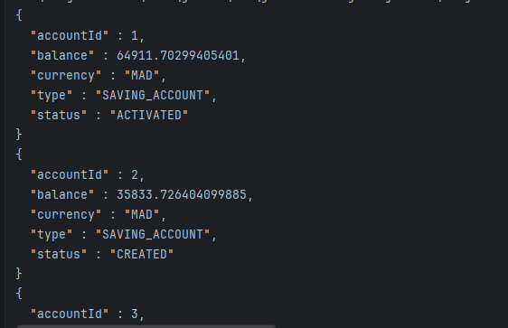
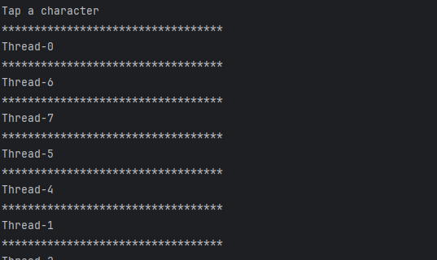

## Methodes de creation de l'objet :
### avec consctructeur
### setters
### builder

apres director et populatedata

JsonSerializer :

Singleton pattern with multi thread env : 

probleme : PLusieurs thread modifie la meme variable
solution : synchronisation de cette variable